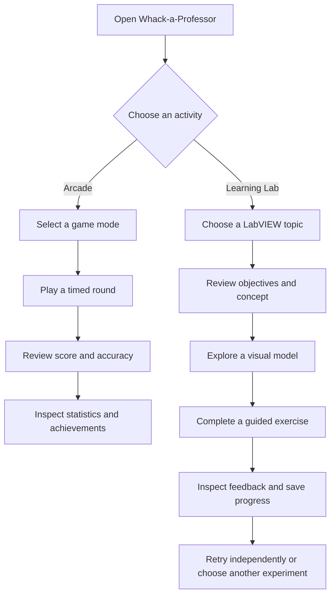
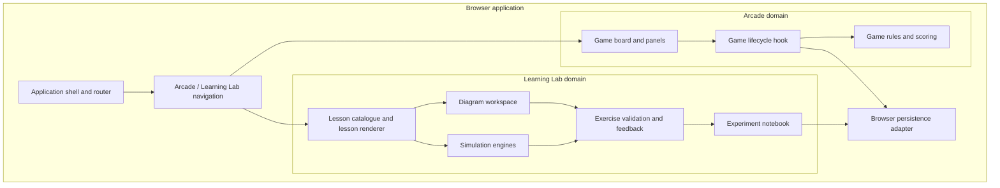
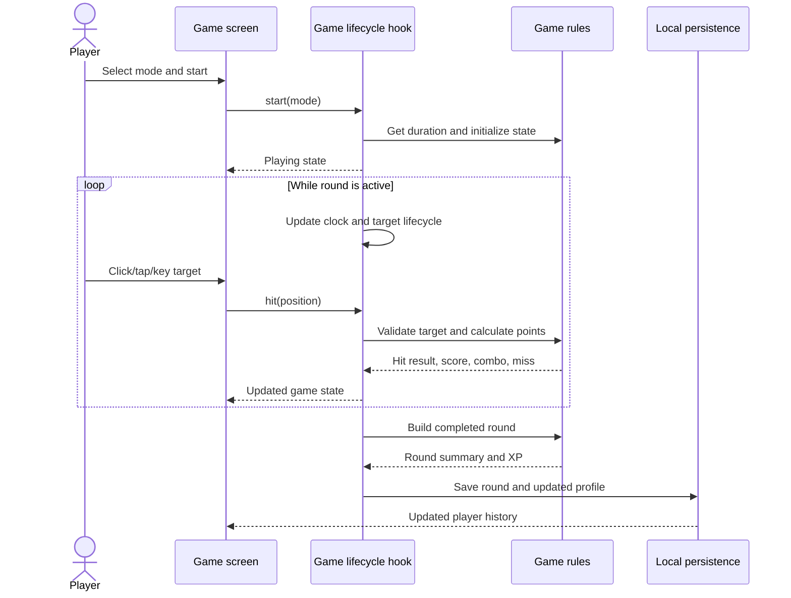
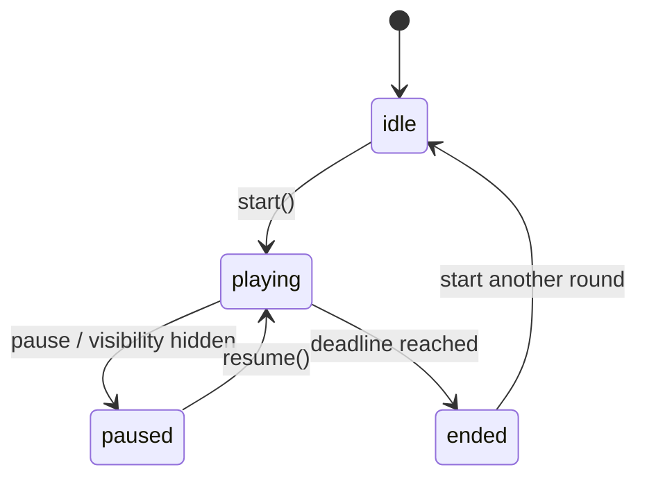
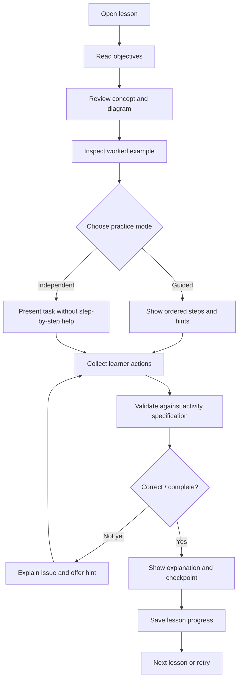
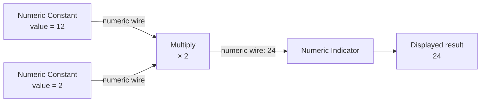
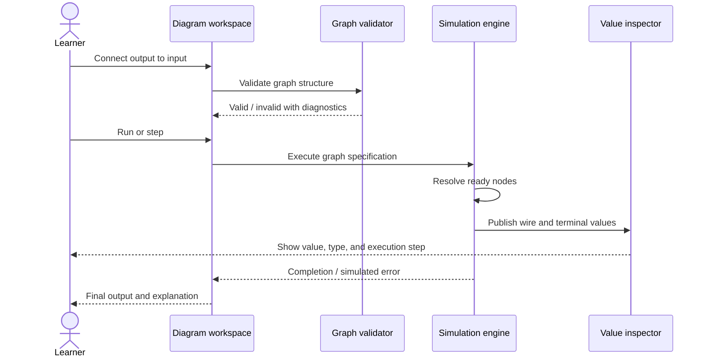
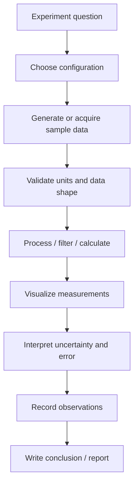
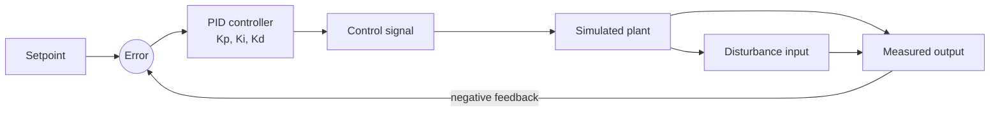
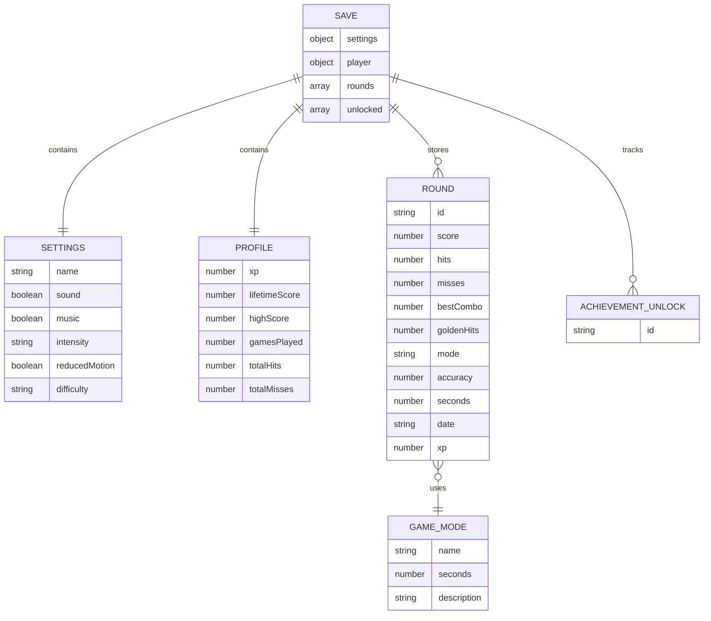

# Whack-a-Professor

> **An arcade-style engineering playground for learning LabVIEW concepts through physics, programming, and delightfully questionable academic decisions.**

Whack-a-Professor combines a fast reaction game with a hands-on learning environment for college engineering students. The arcade layer turns timing, accuracy, state, and feedback into a playful challenge. The Learning Lab connects those ideas to LabVIEW programming concepts, instrumentation, signal processing, debugging, and control systems through guided, inspectable browser simulations.

The project is intentionally playful, but the engineering explanations are not: learners are encouraged to predict outcomes, inspect values, diagnose faults, and explain why a design works.

> **Simulation notice:** Browser-based LabVIEW activities are educational models. They teach concepts associated with LabVIEW, but they do not compile or execute native `.vi` files and do not communicate with physical National Instruments hardware unless a separately configured hardware integration is explicitly provided. Virtual instruments and sample data are labelled as simulated.

---

## Table of Contents

- [01 · Product Overview](#01--product-overview)
- [02 · Features and Learning Outcomes](#02--features-and-learning-outcomes)
- [03 · Technology Stack and Local Setup](#03--technology-stack-and-local-setup)
- [04 · System Architecture](#04--system-architecture)
- [05 · Arcade Engine and Game Rules](#05--arcade-engine-and-game-rules)
- [06 · Learning Lab and LabVIEW Teaching Model](#06--learning-lab-and-labview-teaching-model)
- [07 · Diagram Simulation and Debugging Architecture](#07--diagram-simulation-and-debugging-architecture)
- [08 · Engineering Experiments and Virtual Instruments](#08--engineering-experiments-and-virtual-instruments)
- [09 · Data Model, Persistence, and Privacy](#09--data-model-persistence-and-privacy)
- [10 · Accessibility, Quality, and Contribution Guide](#10--accessibility-quality-and-contribution-guide)
- [Appendix A · Engineering Glossary](#appendix-a--engineering-glossary)
- [Appendix B · Troubleshooting](#appendix-b--troubleshooting)

---

# 01 · Product Overview

## 1.1 Why the project exists

LabVIEW is easier to approach when abstract programming ideas are connected to things students can see and manipulate. A loop becomes more memorable when it controls a running game. A Boolean becomes easier to understand when it lights an indicator. A shift register becomes tangible when a score carries from one iteration to the next. A waveform becomes more useful when it can be sampled, filtered, and interpreted.

Whack-a-Professor uses that connection in two complementary ways:

1. **Arcade learning:** a compact reaction game provides immediate feedback through targets, timing, scoring, combos, and statistics.
2. **Engineering learning:** an interactive Learning Lab explains the programming and physics ideas behind the mechanics through diagrams, guided activities, experiments, and troubleshooting challenges.

The central teaching loop is:

**See a concept → predict what will happen → interact with a model → inspect the result → explain the behavior → retry with a variation.**

## 1.2 Intended audience

The primary audience is college-level engineering students, especially learners in introductory courses involving:

- LabVIEW fundamentals and graphical dataflow programming.
- Instrumentation and measurement systems.
- Introductory electronics and sensor interfaces.
- Data acquisition and experiment logging.
- Signal sampling, filtering, and frequency-domain analysis.
- Control systems and PID concepts.
- Technical reporting and experimental interpretation.

The application is designed for individual practice, demonstrations, study groups, and classroom workshops. It does not replace a course, a hardware lab, or the official LabVIEW development environment.

## 1.3 Product principles

| Principle | Product interpretation |
|---|---|
| Learn by doing | The learner changes inputs and sees the model respond. |
| Make state visible | Values, loop steps, signals, and transitions can be inspected. |
| Explain mistakes | Feedback describes the likely cause and a corrective action. |
| Keep it playful | The professor, laboratory jokes, and arcade feedback lower the intimidation barrier. |
| Be technically honest | Simulations are labelled; hardware and AI integrations are not implied when absent. |
| Preserve learner agency | Hints are progressive, exercises can be reset, and guided practice can lead to independent practice. |
| Prefer reusable systems | Lessons use shared visual components and typed content models. |

## 1.4 Typical user journey



## 1.5 What success looks like

A successful session should leave a learner with more than a score. The learner should be able to describe at least one programming or engineering concept, interpret the result of a controlled experiment, and identify one debugging step they could apply in a real LabVIEW project.

---

# 02 · Features and Learning Outcomes

## 2.1 Arcade game

The arcade is a nine-position Whack-a-Mole-style board featuring an original cartoon physics professor. Players select a mode, react to appearing targets, avoid decoys, build combos, and review their results.

### Game modes

| Mode | Duration | Teaching/arcade twist |
|---|---:|---|
| Classic | 30 seconds | The introductory reaction challenge with normal targets and occasional decoys. |
| Sprint | 15 seconds | A short, faster round with a higher base score per hit. |
| Endurance | 60 seconds | A longer round in which target timing becomes more demanding. |
| Quantum Chaos | 30 seconds | Multiple simultaneous possibilities, including a decoy target. |
| Golden Professor | 30 seconds | A rare golden target awards a large bonus. |

### Player-facing systems

- Live score, timer, current combo, best combo, hit count, miss count, and accuracy.
- Mouse and touch interaction with a nine-position board.
- Keyboard positions mapped to `Q W E / A S D / Z X C`.
- Sound effects, optional soundtrack behavior, animation intensity, and reduced-motion preference.
- Pause/resume controls and automatic pause when the browser document becomes hidden.
- Round summaries, achievements, personal statistics, and a leaderboard combining local results with clearly identified demo rivals.

## 2.2 Learning Lab

The Learning Lab turns the programming structures represented by the game and the wider engineering curriculum into practical exercises.

| Learning domain | Example activities | Learner outcome |
|---|---|---|
| LabVIEW interface | Front Panel controls, indicators, charts, graphs | Distinguish inputs from outputs and design a readable instrument panel. |
| Block Diagram | Nodes, terminals, wires, dataflow | Explain how data dependencies determine execution. |
| Data types | Numeric, Boolean, string, array, cluster, enum | Select compatible representations and recognize conversions. |
| Structures | For Loops, While Loops, Case Structures, Event Structures | Predict iteration, selection, and event behavior. |
| State and parallelism | Shift registers, state machines, queues, producer-consumer | Explain state retention, message flow, and concurrency risks. |
| Modular design | SubVIs, connector panes, reusable libraries | Design smaller, reusable units with clear interfaces. |
| Debugging | Probes, breakpoints, execution highlighting, error wires | Trace values and isolate likely causes of faults. |
| Measurement | Sampling, units, sensors, calibration, uncertainty | Interpret measured values with appropriate context. |
| Signal processing | Signal generation, filtering, FFT, SNR | Relate sampling and processing choices to signal behavior. |
| Control systems | Feedback, PID, step response, stability | Interpret the effect of control parameters on a simplified plant. |
| Experiment practice | Logging, notebooks, analysis, reports | Document a reproducible experiment and communicate findings. |

## 2.3 Teaching activity pattern

Every substantial lesson follows a consistent sequence:

1. **Problem context:** a real or playful engineering scenario.
2. **Learning objectives:** measurable actions the learner should be able to perform.
3. **Concept explanation:** concise text, diagram, and vocabulary.
4. **Worked example:** a small example with inspectable inputs and outputs.
5. **Interactive practice:** a prediction, wiring, configuration, or interpretation task.
6. **Hint ladder:** progressively more specific help.
7. **Feedback:** why an answer is correct or incorrect.
8. **Checkpoint:** a short reflection or knowledge check.

Guided mode makes the next action explicit. Independent mode removes step-by-step assistance while keeping the same task and validation rules.

## 2.4 Learning through the game itself

The arcade is also a useful source of programming examples:

- Random target selection demonstrates selection and random-number logic.
- A countdown demonstrates timing and state transitions.
- Score and combo values demonstrate state carried across iterations.
- Hit and miss events demonstrate event-driven updates.
- Target types demonstrate case selection and different outcomes.
- Results and statistics demonstrate data aggregation and visualization.

The mapping is conceptual: the web implementation is written in TypeScript, while the Learning Lab explains how equivalent ideas can be represented in LabVIEW.

---

# 03 · Technology Stack and Local Setup

## 3.1 Technology overview

The repository is a React and TypeScript application using the TanStack Start ecosystem.

| Layer | Technology | Responsibility |
|---|---|---|
| Language | TypeScript | Typed game rules, application state, and UI contracts. |
| UI | React 19 | Component composition and interactive application screens. |
| Full-stack application framework | TanStack Start | Application shell and route-aware rendering. |
| Routing | TanStack Router | Route matching and route tree. |
| Build/development | Vite 8 | Local development server and production bundling. |
| Styling | Tailwind CSS 4 and project CSS tokens | Responsive layout and visual system. |
| UI primitives | Radix UI-based components | Accessible dialogs, controls, tabs, and other primitives. |
| Charts | Recharts | Game statistics and educational chart views. |
| Icons | Lucide React | Consistent interface iconography. |
| Tests | Vitest and Testing Library | Automated test execution and component-level verification. |
| Formatting/linting | Prettier and ESLint | Consistent code style and static checks. |

The project uses a Bun lockfile and also exposes standard npm scripts. Use the package manager selected by the team and keep the lockfile consistent with that choice.

## 3.2 Prerequisites

- A current Node.js release compatible with the installed Vite version.
- npm or Bun.
- Git.
- A modern browser with JavaScript enabled.

No account or database is required for local arcade play and browser-local progress storage.

## 3.3 Clone and install

```bash
git clone <YOUR_GITHUB_REPOSITORY_URL>
cd <REPOSITORY_DIRECTORY>

# npm workflow
npm install

# Or, when using Bun and the committed bun.lock
bun install
```

## 3.4 Run locally

```bash
npm run dev
```

Open the local URL printed by Vite in the terminal. Keep the terminal process running while developing.

## 3.5 Available project scripts

```bash
npm run dev       # Start the Vite development server
npm run build     # Create the production build
npm run build:dev # Create a development-mode build
npm run preview   # Preview a production build locally
npm run lint      # Run ESLint
npm run format    # Format project files with Prettier
npm run test      # Run the Vitest suite once
npm run test:watch # Run Vitest in watch mode
```

## 3.6 Production build

```bash
npm run lint
npm run test
npm run build
npm run preview
```

A successful local preview is a useful final check, but deployment configuration still depends on the hosting platform and the TanStack Start adapter/runtime selected for the deployment target.

---

# 04 · System Architecture

## 4.1 High-level architecture

The application is organized around a browser-facing React UI, domain logic for the arcade, and reusable educational simulation models. Game rules are kept outside presentation components so they can be tested independently. The Learning Lab follows the same separation: content describes the lesson, simulation logic calculates the result, and UI components present controls and feedback.



## 4.2 Architectural boundaries

### Presentation layer

The presentation layer owns layout, visual states, navigation, accessible controls, dialogs, charts, and feedback. It should not independently reimplement game scoring or scientific calculations.

### Domain layer

The domain layer owns deterministic rules and calculations. Examples include scoring, accuracy, combo bonuses, achievement progress, array operations, unit conversions, filter demonstrations, and exercise validation.

### State orchestration layer

React hooks coordinate active interactions. The arcade lifecycle hook manages the round clock, target appearance, pause/resume, keyboard input, and completion. Educational activities manage the selected lesson, simulation inputs, current execution step, hint state, and exercise completion.

### Persistence layer

Browser storage preserves player settings, game history, and learner progress where applicable. Persistence is intentionally local unless a separately configured backend is added. Demo leaderboard content is not treated as a real multi-user service.

## 4.3 Arcade interaction flow



## 4.4 Recommended module responsibilities

| Responsibility | Existing project module | Responsibility boundary |
|---|---|---|
| Game domain types and rules | `src/lib/game.ts` | Modes, settings, scores, achievements, leaderboard helpers, serialization. |
| Active-round lifecycle | `src/hooks/use-game.ts` | Timer, target spawning, hit handling, pause/resume, keyboard events. |
| Main route and screen composition | `src/routes/index.tsx` | Menu, active game, results, dialogs, and top-level state. |
| Board presentation | `src/components/game-board.tsx` | Nine target positions and target interactions. |
| Game information panels | `src/components/game-panels.tsx` | Modes, leaderboard, achievements, statistics, settings, instructions. |
| Character artwork | `src/components/professor.tsx` | Reusable original SVG professor artwork and expressions. |
| Shared visual primitives | `src/components/ui/` | Buttons, dialogs, inputs, charts, tabs, and other controls. |

Educational simulations should follow equivalent boundaries: lesson content should not be coupled to diagram rendering, and a diagram UI should call a typed simulation/validation model rather than embedding scientific rules in event handlers.

## 4.5 Error handling

The application shell includes route-level error and not-found handling. User-facing error states should explain what happened and offer a recovery action where possible. Browser storage can be unavailable or full, so persistence failures should not silently discard the current session; show a clear warning and keep the application usable for the current visit when possible.

---

# 05 · Arcade Engine and Game Rules

## 5.1 Round state

The round lifecycle uses four primary states:

- `idle` — ready to begin.
- `playing` — timer and target lifecycle are active.
- `paused` — the remaining time is preserved and active targets are cleared.
- `ended` — the round is complete and a result record is produced.



## 5.2 Game state model

The active game state includes:

| Field | Meaning |
|---|---|
| `status` | Current lifecycle state. |
| `score` | Accumulated points in the current round. |
| `combo` | Current consecutive valid-hit sequence. |
| `bestCombo` | Highest combo reached in the round. |
| `hits` | Number of valid normal or golden targets hit. |
| `misses` | Missed targets and incorrect target interactions. |
| `goldenHits` | Number of golden targets successfully hit. |
| `remaining` | Time remaining in seconds. |
| `targets` | Active target records, including position, kind, appearance, and expiry times. |
| `feedback` | Recent point feedback displayed on the board. |

## 5.3 Scoring model

A normal target awards a base score, an optional speed bonus, and any combo bonus. Sprint mode uses a higher base score. Golden targets receive an additional bonus. Decoys penalize the player.

The scoring rules can be expressed as:

```text
speedBonus = clamp(round(10 × (1 - elapsedMs / 650)), 0, 10)
baseScore  = Sprint ? 20 : 10
comboBonus = { 3: 5, 5: 10, 10: 25, 20: 50 }[combo] ?? 0

targetPoints =
    decoy  ? -15
    normal ? baseScore + speedBonus + comboBonus
    golden ? baseScore + speedBonus + comboBonus + 50
```

The speed bonus is bounded between 0 and 10 points. The combo bonus is awarded at the configured milestones, not at every combo count.

### Example

A valid Sprint hit with a speed bonus of 8 points and a combo milestone bonus of 10 points awards:

```text
20 base + 8 speed + 10 combo = 38 points
```

A golden target adds 50 more points to the same calculation. A decoy always applies its penalty and breaks the combo.

## 5.4 Accuracy

Accuracy is calculated from valid hits and misses:

```text
accuracyPercent =
    totalAttempts === 0
      ? 0
      : round(hits / (hits + misses) × 100)
```

A decoy interaction is treated as a miss, not a valid hit. A target that expires without being hit also contributes to misses according to the round rules.

## 5.5 Target timing and difficulty

The target lifetime varies by mode:

- Sprint uses a shorter target lifetime.
- Endurance reduces the target lifetime as the round progresses.
- Other modes use the standard target lifetime.
- Easy difficulty extends the target lifetime.
- Hard difficulty shortens the target lifetime.

The target selection logic avoids selecting the same hole on consecutive spawn operations. Quantum Chaos can create a second decoy target. Golden Professor mode occasionally creates a golden target.

## 5.6 End-of-round result

The result record stores:

- Unique round identifier.
- Final score and mode.
- Hit and miss counts.
- Best combo and golden-hit count.
- Accuracy percentage.
- Round duration and completion timestamp.
- Experience points earned.

Endurance mode adds its completion bonus at the end of the round. Experience points are calculated as `max(5, floor(finalScore / 10))`, so a completed low-scoring round still produces a minimum award.

## 5.7 Game timing and duplicate-event protection

The active-round hook uses a monotonic clock (`performance.now()`) for timing rather than relying only on repeated interval counts. A deadline is established when the round starts. Hit handling checks the deadline before awarding points, which prevents a late interaction from being scored after expiry. A synchronous state reference keeps event handlers aligned with the latest state during rapid interaction.

The interval updates the visible state and spawns targets, but the deadline remains the authoritative end condition. This distinction is important because browser timers can be delayed by tab throttling or system load.

---

# 06 · Learning Lab and LabVIEW Teaching Model

## 6.1 The instructional model

The Learning Lab is organized by engineering concepts rather than by a long list of disconnected screens. A lesson is a structured content record with objectives, explanations, examples, one or more interactive activities, hints, and assessment criteria.

A typical lesson record can be represented conceptually as:

```ts
type Lesson = {
  id: string;
  title: string;
  domain: string;
  difficulty: "beginner" | "intermediate" | "advanced";
  objectives: string[];
  sections: LessonSection[];
  activities: ActivityDefinition[];
  checkpoints: CheckpointDefinition[];
};
```

The diagram above is an architectural example. The precise implementation type names may differ, but lesson content should remain separate from component-specific JSX.

## 6.2 LabVIEW concepts covered

### Front Panel

The Front Panel is introduced as the user-facing interface of a VI. Lessons distinguish controls, which provide input, from indicators, which display output. Activities include numeric controls, Boolean buttons, switches, knobs, text fields, LEDs, charts, tables, and status displays.

### Block Diagram

The Block Diagram is taught as the graphical representation of program logic. Nodes perform operations, terminals expose inputs and outputs, and wires carry typed data. The teaching model emphasizes data dependencies rather than assuming that execution is simply left-to-right.

### Data types

Activities introduce numeric values, Boolean values, strings, arrays, clusters, enums, and error-cluster concepts. Learners inspect example values, choose valid connections, and explore conversions or incompatible types.

### Structures

The curriculum includes For Loops, While Loops, Case Structures, Event Structures, shift registers, tunnels, and state-machine patterns. Each structure has a small simulation that exposes the current iteration, selector, state, or stored value.

### Modular programming

SubVI lessons explain reusable logic, input/output terminals, connector panes, type consistency, and VI hierarchy. The emphasis is on making interfaces clear and reducing duplicated logic.

### Debugging

Debugging lessons cover broken wires, incorrect values, probes, execution highlighting, breakpoints, error wires, and a symptom-driven troubleshooting process.

## 6.3 Lesson and activity lifecycle



## 6.4 Exercise feedback

Feedback should be specific enough to teach a correction. A validation result should identify:

- What the learner attempted.
- Which requirement was satisfied or missed.
- Why the result matters.
- A recommended next step.
- Whether the learner can retry, reveal a hint, or inspect the worked solution.

The system should avoid feedback that only says “incorrect.” It should also avoid treating hints as failure; asking for help is a normal part of engineering problem solving.

## 6.5 Guided and independent modes

Guided mode can highlight the next terminal, node, input, parameter, or configuration step. Independent mode uses the same underlying task definition and validation logic but removes the step-by-step prompts. Switching modes should preserve the learner's current work whenever that is meaningful for the activity.

## 6.6 Concept-to-game mapping

| Whack-a-Professor mechanic | LabVIEW concept | Teaching explanation |
|---|---|---|
| Random target location | Random number and selection logic | Choose a target position from a finite set. |
| Nine target positions | Array indexing | Map a numeric index to a visible board cell. |
| Target appears and expires | Timing and loop behavior | Update the simulation while a time condition remains true. |
| Click or key action | Event Structure | Respond to user input as an event. |
| Score accumulation | Shift register | Carry a value from one loop iteration to the next. |
| Normal / decoy / golden target | Case Structure | Select behavior based on a target type. |
| Countdown and end screen | State machine | Move between idle, active, paused, and ended states. |
| Results and charts | Data logging and visualization | Summarize measurements and inspect trends. |

---

# 07 · Diagram Simulation and Debugging Architecture

## 7.1 Purpose of the Block Diagram workspace

The simulated Block Diagram workspace teaches the structure and reasoning of graphical programming. It is not a general-purpose LabVIEW editor. Its job is to give learners a small, safe environment in which they can connect nodes, inspect data types, step through a simulated execution, and diagnose intentionally introduced faults.

## 7.2 Diagram model

A diagram is represented as a graph:

- **Node:** an operation or structure.
- **Terminal:** an input or output port on a node.
- **Wire:** a directed connection from an output terminal to an input terminal.
- **Value:** the data associated with a terminal or wire during simulation.
- **Execution step:** a node evaluation when its required inputs are available.
- **Validation rule:** a constraint describing a correct solution for a particular exercise.



This simple example demonstrates that a node needs its input values before its output can be calculated. The indicator displays the result produced by the simulated operation.

## 7.3 Graph validation

An exercise specification describes the expected graph or accepted graph variants. Validation should consider more than whether two visual objects appear close together. It should verify that:

- Required nodes exist.
- Required terminals are connected.
- Connection direction is valid.
- Source and destination types are compatible.
- Required inputs are present.
- The graph meets exercise-specific constraints.
- The final output matches the expected value or accepted range.

A validation response should return structured feedback so the UI can highlight the relevant node, terminal, or wire.

## 7.4 Simulated execution

The execution engine evaluates the graph using dependency order. A node becomes eligible when its required input values are available. The engine records each step so the UI can provide play, pause, step-forward, restart, and execution-speed controls.



## 7.5 Debugging tools

| Tool | Teaching use |
|---|---|
| Wire probe | Inspect the value and data type at a connection. |
| Execution highlighting | Observe which node is currently being evaluated. |
| Step execution | Examine one operation at a time. |
| Breakpoint | Pause at a selected location to inspect intermediate state. |
| Broken-wire diagnostics | Identify missing or incompatible connections. |
| Error wire visualization | Follow error information through a chain of operations. |
| Troubleshooting decision tree | Move from a visible symptom to a likely cause and next diagnostic action. |

## 7.6 Data type rules

Type checking is explicit. For example, a numeric output can connect to a compatible numeric input. A string output should not silently become a numeric input without a conversion step. Arrays and scalars are not interchangeable merely because both contain numbers. A cluster is a grouped structure with fields whose names and types matter.

The simulated wire palette may use color, but color must never be the only signal. The interface should display text labels, type names, and accessible descriptions.

## 7.7 Simulation limitations

The educational engine executes the supported subset defined by its activity model. It should not imply support for arbitrary LabVIEW primitives, VI packages, native execution, or file formats. If an activity models a simplified behavior, the lesson should state the assumption and link to the underlying concept.

---

# 08 · Engineering Experiments and Virtual Instruments

## 8.1 Experiment structure

Engineering activities should model the logic of a real experiment: define a question, choose parameters, collect or generate measurements, process values, inspect results, and communicate a conclusion.



## 8.2 Signal generation and sampling

The signal laboratory introduces sine, square, triangle, and noise waveforms. Learners adjust amplitude, frequency, offset, and sample rate. The display compares an underlying reference curve with sampled points.

The key learning outcomes are:

- Understand the relationship between frequency and period.
- Distinguish sample rate from signal frequency.
- Recognize how under-sampling can cause aliasing.
- Interpret the effect of changing a sample interval.
- Explain why a signal should be sampled appropriately for the phenomenon being measured.

Sample data should be deterministic when reproducibility is important. For random noise, use a seeded generator so the same configuration can be replayed during assessment.

## 8.3 Filtering and frequency analysis

Filter activities compare an input signal with a processed output. The learner can adjust low-pass, high-pass, and band-pass settings and inspect the effect on the waveform and frequency-response view. FFT activities show a frequency-domain representation and identify dominant spectral components.

The model should explain that filter behavior depends on filter design, order, cutoff settings, and implementation details. A simplified browser activity is an educational approximation and must not be presented as a substitute for a production measurement system.

## 8.4 Measurement and calibration

Measurement activities cover:

- Measurement units and dimensional consistency.
- Sensor ranges and channel configuration.
- Calibration offset and gain error.
- Repeated measurements and basic descriptive statistics.
- Mean, range, and standard deviation.
- Measurement uncertainty and tolerance.
- Time stamps, channel names, and data provenance.

A measurement should be displayed with its unit and relevant configuration. A number without a unit or channel identity is incomplete engineering information.

## 8.5 Virtual DAQ and instrument panels

The application can provide simulated device and channel panels to demonstrate the configuration and measurement workflow. Example devices, channels, thermocouple readings, strain-gauge responses, and oscilloscope traces must be visibly labelled **SIMULATED** unless verified physical hardware is actually connected through a supported integration.

The virtual oscilloscope teaches timebase, volts per division, trigger level, channel selection, peak-to-peak amplitude, and period. Display scaling changes the view; it does not automatically change the underlying signal data.

## 8.6 PID and feedback control

A control-system activity uses a simplified plant model and lets learners adjust proportional, integral, and derivative gains. The display should include the setpoint, process variable, control effort, and error over time.



The learner should be able to compare open-loop and closed-loop behavior, apply a disturbance, and inspect overshoot, settling behavior, oscillation, and steady-state error where the model supports those metrics.

**Important:** PID tuning is system-dependent. The teaching model must not imply that one set of gains is suitable for every physical process.

## 8.7 Lab notebook and report workflow

A lab notebook should preserve the context of an experiment, not just its final number. A useful entry includes:

- Question or objective.
- Hypothesis.
- Configuration and parameter values.
- Sample source or simulation label.
- Observations.
- Results and units.
- Known limitations or anomalies.
- Conclusion.

A report generator, when enabled, should receive only the telemetry and notes selected for that report. Any external AI provider must be configured explicitly, and API secrets must remain server-side. A deterministic template-based report should remain available when AI is disabled or unreachable. Generated prose must not invent measurements or claim that a physical experiment was performed when the data came from a simulation.

---

# 09 · Data Model, Persistence, and Privacy

## 9.1 Game data model

The arcade domain defines typed records for modes, settings, targets, rounds, player profiles, achievements, leaderboard rows, and the overall save object.

A completed round contains enough information to reconstruct the player's personal history and calculate progress without storing every animation frame.



## 9.2 Local persistence

The arcade save object is stored in browser `localStorage` under the key:

```text
whack-a-professor-v1
```

The save contains:

- Player settings and display name.
- Player profile totals.
- Completed round history.
- Unlocked achievement identifiers.

The save reader merges stored settings and profile values with defaults and guards against invalid JSON. If browser storage is unavailable, the interface should show a warning rather than suggesting that progress has been synchronized to a server.

## 9.3 Demo data versus personal data

Some screens can begin with sample profile values, sample statistics, or fictional leaderboard entries so the interface is populated on first launch. These records are demonstration content, not real players or a live online competition.

The UI should keep the distinction visible:

- Demo leaderboard rows are labelled as demo data.
- Local results are identified as the current player's local records.
- Sample charts are labelled as sample history until the learner has real local rounds.
- Demo achievements or starting profile totals should not be represented as verified personal accomplishments.

## 9.4 Learning progress data

Educational progress should use a separate namespace or a separately versioned storage record. Suggested logical entities include:

| Entity | Example fields | Purpose |
|---|---|---|
| Lesson progress | lesson ID, status, last opened, completion date | Track the learner's progress through a lesson. |
| Activity attempt | activity ID, inputs, result, hint count, timestamp | Record an exercise attempt. |
| Experiment record | experiment ID, configuration, data source, results | Preserve experiment context. |
| Notebook entry | title, hypothesis, observations, conclusion | Keep the learner's lab notes. |
| Preferences | guided mode, reduced motion, display options | Personalize the learning interface. |

The specific storage schema should be versioned so future updates can migrate old records safely.

## 9.5 Privacy and security principles

- Do not require a user account for features that work entirely in the browser.
- Do not collect or transmit personal information without a clearly disclosed feature and purpose.
- Do not put API keys or other secrets in browser JavaScript or committed configuration files.
- Do not imply that local browser storage is encrypted or shared across devices.
- Clearly identify demo and synthetic data.
- If a backend or AI report integration is added, document data transmitted, retention behavior, provider configuration, and failure handling.
- Provide a way to reset local settings and progress with a clear confirmation step.

---

# 10 · Accessibility, Quality, and Contribution Guide

## 10.1 Accessibility requirements

The interface should remain usable by learners with different input methods and motion preferences.

- All interactive controls need accessible names.
- Keyboard focus must be visible.
- Dialogs must have meaningful titles and descriptions.
- Do not rely on color alone to communicate wire type, correctness, target type, or status.
- Provide keyboard alternatives for pointer-driven diagram activities.
- Respect reduced-motion preferences.
- Ensure charts have readable labels and supporting text or summaries.
- Provide clear feedback for invalid input and unavailable storage.
- Ensure the game board can be operated using the documented keyboard layout.

## 10.2 Responsive behavior

The application should support desktop, tablet, and phone layouts. On small screens:

- Stack the game score rail, board, and lab notes rather than forcing horizontal overflow.
- Keep the nine target positions large enough to tap.
- Move diagram explanations below the workspace while preserving the selected item.
- Use touch-friendly controls for sliders, graph cursors, and wiring activities.
- Keep essential controls visible without requiring precision dragging.
- Allow tables and code-like panels to scroll horizontally when they cannot reflow safely.

## 10.3 Reduced motion and sound

Sound effects, music, animation intensity, and reduced-motion preferences are settings rather than mandatory parts of gameplay. Important state changes must remain understandable when sound is disabled or animation is reduced. A sound should never be the only cue that a hit, miss, or completion occurred.

## 10.4 Testing strategy

The repository includes a Vitest test command. Core behavior should be tested independently of the rendered screen wherever possible.

Recommended test coverage:

| Area | High-value tests |
|---|---|
| Game rules | Mode duration, accuracy, combo thresholds, scoring, target selection. |
| Persistence | Valid save parsing, malformed JSON fallback, default merging, round aggregation. |
| Round lifecycle | Start, pause, resume, expiry, no post-deadline scoring. |
| Input | Keyboard mapping, click handling, ignored inputs in text fields. |
| Achievements | Progress calculation and unlock conditions. |
| Diagram validation | Missing node, invalid wire, type mismatch, correct output. |
| Simulations | Deterministic outputs for fixed inputs and supported ranges. |
| Scientific calculations | Unit conversion, sampling calculations, statistics, filter model invariants. |
| Accessibility | Keyboard operation, accessible names, dialog behavior, reduced motion. |
| Responsive UI | Small-screen layout, scroll behavior, and usable touch targets. |

## 10.5 Quality gates

Before merging a change, run:

```bash
npm run lint
npm run test
npm run build
```

Also perform a manual smoke test:

1. Open the home screen.
2. Start a round in each game mode.
3. Pause and resume a round.
4. Complete a round and review the result.
5. Refresh the browser and verify local data restoration.
6. Open settings and test sound, difficulty, and reduced-motion options.
7. Open the Learning Lab and complete a guided exercise.
8. Repeat the exercise in independent mode.
9. Test a wrong answer and confirm that the feedback is useful.
10. Repeat core interactions using keyboard navigation and a narrow viewport.

## 10.6 Contribution workflow

1. Create a focused branch for the change.
2. Keep game rules, educational models, and UI presentation separated.
3. Prefer small reusable components over page-specific duplicated logic.
4. Add or update tests for changed calculations and state transitions.
5. Update lesson explanations when simulation behavior changes.
6. Label new synthetic data and virtual instruments clearly.
7. Run lint, tests, and a production build.
8. Open a pull request describing the user-visible change, technical behavior, and verification performed.

### Suggested pull request checklist

- [ ] The change has a clear user or learning outcome.
- [ ] Existing game behavior is preserved unless intentionally changed.
- [ ] Educational explanations match the simulation behavior.
- [ ] Sample data and hardware simulations are clearly labelled.
- [ ] Keyboard and touch interactions are usable.
- [ ] Reduced-motion and accessibility behavior are considered.
- [ ] Tests cover new business rules or calculations.
- [ ] Lint, tests, and build complete successfully.
- [ ] Documentation is updated.

## 10.7 Repository notes

The supplied repository snapshot identifies the project as a Lovable-connected application and includes project guidance for preserving published Git history and keeping Lovable-managed database, generated-file, and secret configuration changes within the appropriate workflow. Contributors should review `AGENTS.md` before making changes to project configuration or deployment-managed resources.

No license file was present in the supplied repository snapshot. Add and review a `LICENSE` file before distributing the project as open source or accepting external contributions under a particular license.

---

# Appendix A · Engineering Glossary

| Term | Plain-language definition |
|---|---|
| Block Diagram | The graphical programming view that describes operations and their data connections. |
| Front Panel | The user interface of a LabVIEW VI, containing controls and indicators. |
| Control | A Front Panel object used to provide input to a VI. |
| Indicator | A Front Panel object used to display output from a VI. |
| Node | A diagram element that performs an operation or represents a structure. |
| Terminal | An input or output connection point on a node or Front Panel object. |
| Wire | A typed data connection between terminals. |
| Dataflow | An execution model in which operations become ready when required input data is available. |
| VI | Virtual Instrument; a LabVIEW program or module. |
| SubVI | A VI used as a reusable component within another VI. |
| Shift register | A loop mechanism for carrying data from one iteration to the next. |
| Tunnel | A loop boundary connection used to pass data into or out of a structure. |
| Case Structure | A selection structure that executes a case based on a selector value. |
| Event Structure | A structure that handles configured UI or programmatic events. |
| State machine | A design pattern that selects behavior based on the current state and an event or condition. |
| Queue | A first-in-first-out mechanism commonly used to pass messages between parallel tasks. |
| Probe | A debugging aid for inspecting a value on a wire during execution. |
| DAQ | Data acquisition; collecting signals from sensors or instruments. |
| Sampling rate | The number of samples collected per unit of time. |
| Aliasing | A sampling effect in which a signal can appear to have a different frequency than it actually has. |
| FFT | Fast Fourier Transform; an algorithm used to compute a discrete frequency-domain representation. |
| SNR | Signal-to-noise ratio; a measure comparing signal strength with noise level. |
| PID | Proportional-integral-derivative control algorithm used in feedback control systems. |
| Setpoint | The desired target value for a control system. |
| Process variable | The measured value representing the current state of the process. |
| Overshoot | The amount by which a response exceeds its target during a transient. |
| Settling time | The time required for a response to remain within a defined band around its final value. |
| Calibration | Comparing or adjusting a measurement system against a known reference. |
| Uncertainty | A quantified description of the dispersion or doubt associated with a measurement. |

# Appendix B · Troubleshooting

| Symptom | Likely cause | Recommended action |
|---|---|---|
| The app does not start | Dependencies are missing or the runtime is incompatible | Reinstall dependencies and check the Node.js version required by the installed Vite release. |
| A local score does not survive refresh | Browser storage is blocked, unavailable, or full | Check browser privacy settings and available storage; look for the in-app storage warning. |
| Leaderboard entries look unfamiliar | The board includes fictional demo records | Check the demo-data label; local records are marked separately. |
| A round ends unexpectedly after switching tabs | The app pauses when the document becomes hidden | Return to the tab and resume the paused round. |
| A keyboard hit does not register | Focus is in a text input or the key is not mapped to a board position | Move focus out of text controls and use `Q W E / A S D / Z X C`. |
| A simulated wire is rejected | The source and destination data types are incompatible | Inspect both terminal types and add an appropriate conversion in the exercise. |
| A simulation result differs from a textbook example | The activity may use a simplified model or different sample parameters | Review the lesson assumptions, units, and configured values. |
| A virtual instrument shows changing values | The activity is generating sample data | Check the **SIMULATED** label; do not interpret it as a physical hardware measurement. |
| A report service is unavailable | Optional AI/provider configuration is absent or unreachable | Use the deterministic report fallback and verify server-side provider configuration. |

---

## Project status and scope

Whack-a-Professor is an integrated engineering learning environment: the arcade experience, Learning Lab lessons, diagram activities, virtual instruments, experiment workflows, and progress summaries are presented as one product. The technical boundary is deliberate: the browser teaches and simulates LabVIEW concepts, while native VI authoring, compilation, and physical DAQ operation are performed by LabVIEW and any separately configured hardware integration. **A browser simulation is not a native VI or a physical measurement.**
